# Session 3 — Descriptive Statistics: Complete Study Notes

> **Language:** Simple English + বাংলা  
> **Source:** `Session 3 - Descriptive Statistics.pdf` (15 lecture pages)  
> **Purpose:** Build intuition for Probability, Statistics, Data Science & Machine Learning.  
> **How to view:** Keep this Markdown file next to the `graphs/` folder. Open in VS Code Markdown Preview, Obsidian, or another Markdown viewer supporting LaTeX math.

**Source vs. explanation:** Each section follows the lecture's page order. Worked examples, detailed formulas, diagrams, ML use cases, and corrections are teaching additions, not necessarily content explicitly printed on the slide. In particular, the slide on page 8 lists Poisson alongside continuous PDF examples; **Poisson is discrete and has a PMF**, not a continuous PDF. Some slide figures/handwriting contain more detail than their text extraction; this guide explains the principal concepts rather than reproducing every handwritten mark.

## Table of contents

1. [Page 1 — Random Variables](#page-1--random-variables)
2. [Page 2 — Probability Distributions](#page-2--probability-distributions)
3. [Page 3 — Types of Probability Distributions](#page-3--types-of-probability-distributions)
4. [Page 4 — Importance and Parameters](#page-4--why-distributions-matter-and-parameters)
5. [Page 5 — Probability Distribution Functions](#page-5--probability-distribution-functions)
6. [Page 6 — PMF](#page-6--probability-mass-function-pmf)
7. [Page 7 — Discrete CDF](#page-7--cdf-of-a-discrete-random-variable)
8. [Page 8 — PDF](#page-8--probability-density-function-pdf)
9. [Page 9 — Density Estimation](#page-9--density-estimation)
10. [Page 10 — Parametric Estimation](#page-10--parametric-density-estimation)
11. [Page 11 — Non-Parametric Estimation](#page-11--non-parametric-density-estimation)
12. [Page 12 — KDE](#page-12--kernel-density-estimation-kde)
13. [Page 13 — Continuous CDF](#page-13--cdf-of-a-continuous-pdf)
14. [Page 14 — PDF/CDF in Analysis](#page-14--using-pdf-and-cdf-in-data-analysis)
15. [Page 15 — 2D Density](#page-15--2d-probability-density-plots)
16. [Formula sheet](#formula-sheet)
17. [Common mistakes](#common-mistakes)
18. [Practice questions](#practice-questions-no-answers-yet)

---

## Big picture: how everything connects

```text
Random experiment → Random variable (X)
                           ↓
                 Probability distribution
                      /           \
                  Discrete      Continuous
                    ↓              ↓
                   PMF            PDF
                    \              /
                     → CDF ←------
                           ↓
             Estimate unknown distributions
                  /                \
             Parametric      Non-parametric
                                   ↓
                                  KDE
                           ↓
               Visualize 1D / 2D density
```

**বাংলায়:** Random experiment-এর result-কে সংখ্যা দিয়ে প্রকাশ করি random variable হিসেবে। সেই সংখ্যাগুলোর probability pattern হলো distribution। Discrete হলে PMF, continuous হলে PDF; উভয়ের জন্যই CDF আছে। Real data-র distribution অজানা থাকলে density estimation করি।

---

## Page 1 — Random Variables

### 1. Big idea
A **random variable** is a function that assigns a numerical value to each outcome of a random experiment. The numerical value is not known in advance.

**বাংলায়:** Coin toss বা dice roll-এর মতো random experiment থেকে যে ফলাফল আসে, সেটিকে সংখ্যা দিয়ে প্রকাশ করার নিয়মই random variable।

### 2. Algebraic vs random variable
- Algebra: `x + 3 = 7` → solve `x = 4`; the equation determines the unknown.
- Probability: `X = number of heads in 2 coin flips`; before tossing, `X` may be 0, 1, or 2.

| Coin flips | X = heads |
|---|---:|
| TT | 0 |
| HT | 1 |
| TH | 1 |
| HH | 2 |

**Notation:** $X\in\{0,1,2\}$ means “X belongs to the set containing 0, 1, and 2.” Capital $X$ names the random variable; lowercase $x$ usually denotes a specific value.

### 3. Types
- **Discrete:** countable possible values, e.g. number of website clicks, absent students, die result.
- **Continuous:** values anywhere in an interval, e.g. height, temperature, elapsed time in an ideal continuous model.

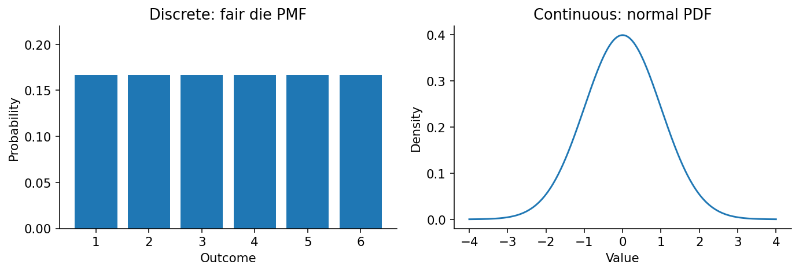

**Important nuance:** Counting integers gives discrete data; recording a measurement rounded to two decimals does not mean the underlying modeled quantity must be discrete.

**ML connection:** binary labels, count predictions, and continuous predictions such as house price all correspond to different kinds of random variables.

**Remember:** A random variable is **not** “a random letter”; it maps random outcomes to numbers.

---

## Page 2 — Probability Distributions

### 1. Meaning
A probability distribution tells us which values a random variable can take and how probability is allocated among them.

**বাংলায়:** কোন কোন ফলাফল সম্ভব এবং কোনটির chance কত—এটাই probability distribution।

### 2. Fair die example

| x | P(X=x) |
|---:|---:|
| 1 | 1/6 |
| 2 | 1/6 |
| 3 | 1/6 |
| 4 | 1/6 |
| 5 | 1/6 |
| 6 | 1/6 |

All probabilities add to $6\times\frac16=1$.

For equally likely outcomes only:

$$P(A)=\frac{\text{number of favorable outcomes}}{\text{number of possible outcomes}}$$

### 3. Why use a function instead of a table?
For a die, six table rows are easy. For rolling 10 dice, there are $6^{10}=60,466,176$ ordered combinations. For continuous heights, infinitely many exact values are possible. A mathematical function provides a compact description.

**Bangla intuition:** কোটি কোটি outcome আলাদা করে table-এ না লিখে একটি mathematical rule দিয়ে pattern বোঝানো যায়।

**Important:** A distribution is the probability law itself. PMF, PDF, and CDF are different mathematical ways to describe it.

---

## Page 3 — Types of Probability Distributions

The slide contrasts **discrete** and **continuous** random variables and their graphical distributions.

| Distribution | Type | Example |
|---|---|---|
| Bernoulli | Discrete | Clicked (1) or not clicked (0) |
| Binomial | Discrete | Heads in 10 independent coin flips |
| Poisson | Discrete | Calls per minute under suitable assumptions |
| Normal / Gaussian | Continuous | Bell-shaped measurement model |
| Exponential | Continuous | Waiting time in a Poisson-process model |
| Log-normal | Continuous | Some positive right-skewed measurements |
| Uniform | Either | Fair die (discrete), random real number in [0,10] (continuous) |


### Example: Bernoulli vs Binomial
- **Bernoulli:** one trial, two outcomes. $P(X=1)=p$ and $P(X=0)=1-p$.
- **Binomial:** count successes in $n$ independent Bernoulli trials with common success probability $p$.

For 2 fair flips, probability of exactly 1 head = $P(HT)+P(TH)=\frac14+\frac14=\frac12$.

**ML connection:** Bernoulli often models binary labels; Poisson may model event counts; Normal often appears in noise models.

---

## Page 4 — Why Distributions Matter and Parameters

### 1. Same mean, different spread
A: `[48,49,50,51,52]` → mean = 50.  
B: `[20,35,50,65,80]` → mean = 50.

Both have the same mean, but B varies much more. A distribution describes more than one summary number.

### 2. Parameters = settings of a distribution
For the normal distribution:

$$X\sim\mathcal N(\mu,\sigma^2)$$

| Symbol | Pronunciation | Meaning |
|---|---|---|
| $X$ | ex | random variable |
| $\sim$ | distributed as | follows the distribution |
| $\mathcal N$ | normal | normal distribution family |
| $\mu$ | mu | mean / center |
| $\sigma$ | sigma | standard deviation / spread |
| $\sigma^2$ | sigma squared | variance |

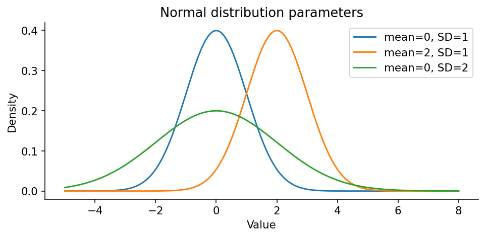

- Increase $\mu$ keeping $\sigma$ fixed → shift the curve horizontally.
- Increase $\sigma$ keeping $\mu$ fixed → make the bell wider and lower.
- A normal curve is symmetric around its mean.

**বাংলায়:** $\mu$ বলে curve কোথায় centered হবে। $\sigma$ বলে data কতটা ছড়াবে। Standard deviation বেশি মানে values সাধারণত center থেকে বেশি দূরে ছড়ানো।

**ML connection:** assumptions about noise distributions, uncertainty intervals, and data normalization often depend on center and spread.

---

## Page 5 — Probability Distribution Functions

### 1. What is a function?
A function follows an input-output rule: $f(x)=2x$, so $f(3)=6$.

Probability uses different functions for different questions:

| Function | Input | Output |
|---|---|---|
| PMF $p_X(x)$ | a discrete value | probability $P(X=x)$ |
| PDF $f_X(x)$ | a continuous value | **density**, not point probability |
| CDF $F_X(x)$ | a cutoff | probability $P(X\le x)$ |

**Terminology warning:** The lecture informally uses “probability distribution function.” In standard probability notation, **PDF** specifically means **probability density function** for continuous distributions. The **CDF** exists for both discrete and continuous distributions.

---

## Page 6 — Probability Mass Function (PMF)

### 1. Definition
A PMF gives the probability of **exactly one value** of a discrete random variable.

$$p_X(x)=P(X=x)$$

- $p_X$: PMF belonging to random variable $X$.
- $x$: one possible value.
- $P(X=x)$: probability that $X$ equals that value.

### 2. Two essential conditions

$$p_X(x)\ge 0\quad\text{for every }x$$

$$\sum_x p_X(x)=1$$

- $\ge$ means greater than or equal to.
- $\sum$ (capital sigma) means add up all terms.
- The subscript $x$ means sum over all possible outcomes.

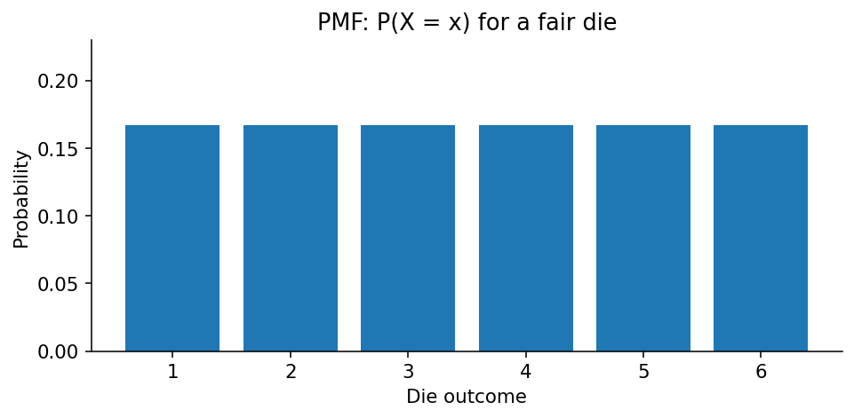

### 3. Numerical example
Fair coin: $X=1$ for heads, $X=0$ for tails.

$$p_X(0)=0.5,\quad p_X(1)=0.5$$

Check: both are non-negative; $0.5+0.5=1$.

**Invalid example:** probabilities 0.7 and 0.6 sum to 1.3 → not a valid PMF.

### 4. Binomial PMF (optional next-level formula)

$$P(X=k)=\binom nk p^k(1-p)^{n-k}$$

- $n$: total number of trials.
- $k$: successes we want.
- $p$: probability of success on one trial.
- $\binom nk$: number of ways to choose which $k$ trials succeed.

For 2 fair flips and exactly 1 head:

$$\binom21 (0.5)^1(0.5)^1=2(0.5)(0.5)=0.5$$

**বাংলায়:** PMF discrete outcome-এর exact probability বলে। “Exactly 3 customers clicked” ধরনের প্রশ্নে PMF কাজে লাগে।

---

## Page 7 — CDF of a Discrete Random Variable

### 1. Definition

$$F_X(x)=P(X\le x)$$

Read: “Probability that X is less than or equal to x.”

**বাংলায়:** $x$ পর্যন্ত সব সম্ভাব্য outcome-এর probability যোগ করো।

### 2. Fair die worked example

$$F_X(3)=P(X\le3)=P(X=1)+P(X=2)+P(X=3)$$

$$=\frac16+\frac16+\frac16=\frac36=0.5$$

| Cutoff x | PMF P(X=x) | CDF P(X≤x) |
|---:|---:|---:|
| 1 | 1/6 | 1/6 |
| 2 | 1/6 | 2/6 |
| 3 | 1/6 | 3/6 |
| 4 | 1/6 | 4/6 |
| 5 | 1/6 | 5/6 |
| 6 | 1/6 | 6/6 = 1 |

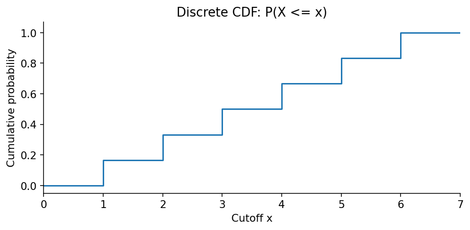

**Why steps?** The CDF jumps at values with positive probability; between possible values it stays flat.

**Properties:** CDF never decreases, stays between 0 and 1, approaches 0 far left and 1 far right.

**Boundary warning:** For a discrete variable, $P(a\le X\le b)=F_X(b)-P(X<a)$; equivalently $F_X(b)-F_X(a^-)$, where $F_X(a^-)$ is the limit just before $a$. Do **not** automatically use $F(b)-F(a)$ for an inclusive discrete interval.

---

## Page 8 — Probability Density Function (PDF)

### 1. Why not point probability?
For a continuous random variable, the probability of any one **exact** point is 0:

$$P(X=170)=0$$

But an **interval** can have positive probability, e.g. $P(169\le X\le171)$.

**বাংলায়:** 170.00000... exact value-এর probability continuous model-এ zero; কিন্তু 169–171-এর মতো range-এর probability বের করা যায়।

### 2. PDF: height is density, area is probability

$$P(a\le X\le b)=\int_a^b f_X(x)\,dx$$

- $a,b$: lower and upper boundaries.
- $f_X(x)$: density at $x$.
- $\int$: integration = accumulate infinitely small strips of area.
- $dx$: tiny movement along the x-axis.

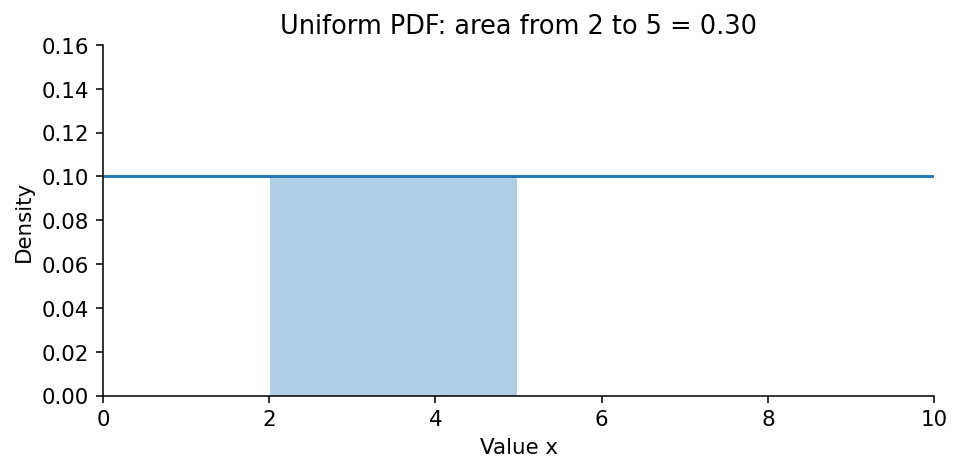

### 3. Easiest possible example: Uniform(0,10)
If all intervals of the same length inside 0–10 have equal probability, density is:

$$f_X(x)=\begin{cases}0.1,&0\le x\le10\\0,&\text{otherwise}\end{cases}$$

Probability between 2 and 5 = rectangle area:

$$P(2\le X\le5)=(5-2)\times0.1=0.3=30\%$$

### 4. Two PDF rules

$$f_X(x)\ge0,\qquad \int_{-\infty}^{\infty}f_X(x)\,dx=1$$

**Important:** A density value can be greater than 1 if the interval is sufficiently narrow. It's the **total area**, not the curve's maximum height, that must equal 1.

### 5. Examples
- Normal: continuous, bell-shaped.
- Log-normal: continuous, positive and often right-skewed.
- **Poisson: discrete**, despite its placement in the PDF slide; use its PMF.

**ML connection:** probability models for measurements, noise, likelihood of continuous observations, and interval probabilities.

---

## Page 9 — Density Estimation

### 1. Problem
You have observed data but don't know the true distribution. **Density estimation** uses observations to estimate the underlying density.

**বাংলায়:** Data দেখে probability density-এর shape অনুমান করা।

### 2. Example
Delivery times `[18,19,20,20,21,22,30,35]` suggest a concentration near 20 minutes, with a few longer deliveries. A histogram groups observations into bins; KDE creates a smooth estimate.

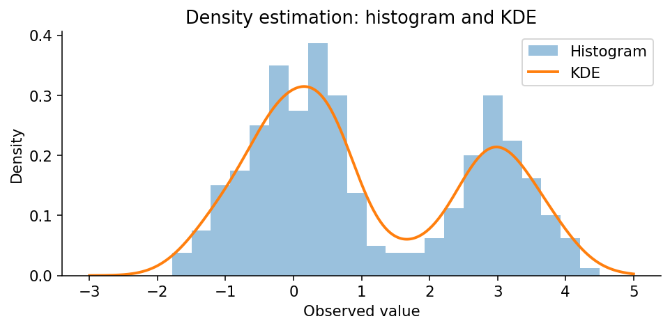

### 3. Common approaches
- **Histogram:** group data into bins; the choice of bin width affects the picture.
- **Parametric estimation:** choose a distribution family and estimate its parameters.
- **Non-parametric estimation:** estimate shape without fixing a particular distribution family.
- **GMM (Gaussian mixture model):** combine multiple Gaussian components; often treated as a flexible **parametric mixture model** when the number of components is fixed.

**Use cases:** exploratory data analysis, anomaly detection, and likelihood modeling. Low estimated density can signal unusual data, but does not prove fraud or error.

---

## Page 10 — Parametric Density Estimation

### 1. Big idea
Assume the observations come from a known distribution family (for example, Normal). Estimate the parameters that best fit the data.

### 2. Worked normal example
Data: `[8,9,10,11,12]`.

Mean:

$$\hat\mu=\frac{8+9+10+11+12}{5}=\frac{50}{5}=10$$

Squared deviations from mean:

| Value | Value − 10 | Squared deviation |
|---:|---:|---:|
| 8 | −2 | 4 |
| 9 | −1 | 1 |
| 10 | 0 | 0 |
| 11 | 1 | 1 |
| 12 | 2 | 4 |
| **Sum** | | **10** |

Under the normal-model maximum likelihood estimator:

$$\hat\sigma^2=\frac{10}{5}=2,\qquad \hat\sigma=\sqrt2\approx1.414$$

Estimated model: $X\sim\mathcal N(10,2)$, where **2 is variance, not SD**.

**Why divide by 5?** This is the normal-model maximum-likelihood variance estimate. For the usual **unbiased sample variance**, divide by $n-1=4$ instead, obtaining $s^2=2.5$.

**বাংলায়:** আগে ধরে নিচ্ছি distribution Normal। এরপর data থেকে mean ও variance estimate করে curve fit করছি। Assumption ভুল হলে fitted model-ও misleading হতে পারে।

---

## Page 11 — Non-Parametric Density Estimation

### 1. Big idea
Estimate the density without assuming one predefined distribution family.

### 2. Intuition
Imagine spending data has two clusters: near ৳800 and near ৳8,000. A single normal curve may hide the two peaks. A flexible estimator can reveal them.

| Question | Parametric | Non-parametric |
|---|---|---|
| Must select distribution family? | Yes | No fixed family needed |
| Flexibility | Depends on chosen family | Often higher |
| Data needed | Can be efficient with smaller samples if model is right | Often needs more data |
| Risk | Wrong family assumption | Overfitting/noise and bandwidth sensitivity |

**বাংলায়:** Data-এর actual shape অনুযায়ী estimate করতে চাই, আগে থেকেই Normal ধরতে চাই না। কিন্তু বেশি flexible হলেই সব সময় better হয় না।

---

## Page 12 — Kernel Density Estimation (KDE)

### 1. Big idea
Put a small smooth **kernel** around each data point; add the kernels to obtain a smooth estimated density.

Example observations: `[2,3,3,4,8]`. There are two observations at 3, so the contributions around 3 overlap strongly.

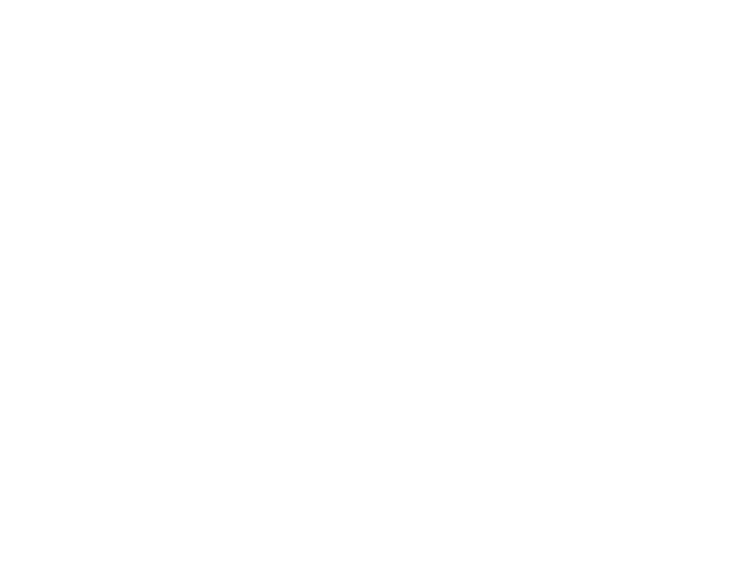

### 2. Formula and symbol-by-symbol explanation

$$\hat f_h(x)=\frac{1}{nh}\sum_{i=1}^{n}K\left(\frac{x-x_i}{h}\right)$$

| Symbol | Meaning |
|---|---|
| $\hat f_h(x)$ | estimated density at x; hat means estimate |
| $n$ | number of observations |
| $h$ | bandwidth (smoothness control) |
| $\sum_{i=1}^{n}$ | add contributions from observation 1 to n |
| $x_i$ | i-th observation |
| $x-x_i$ | distance from x to the i-th observation |
| $K$ | kernel shape, often Gaussian |

### 3. Bandwidth is the key setting

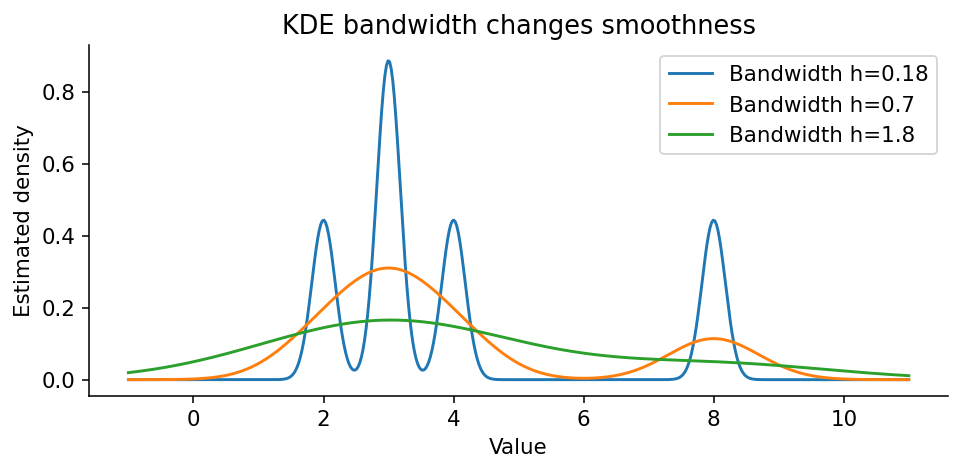

- **Small $h$:** narrow hills → many small bumps; may follow noise (overfitting).
- **Large $h$:** wide hills → very smooth; may hide genuine groups (underfitting).

**বাংলায়:** Bandwidth কম হলে curve বেশি ওঠানামা করে। Bandwidth বেশি হলে curve বেশি smooth হয়। Balance দরকার।

### 4. What does a KDE peak mean?
A high KDE peak means observations are concentrated **near** that region. It does not give the probability of one exact value. Calculate probability from the **area under the KDE curve** over an interval.

**Practical Python:**

```python
import seaborn as sns
import matplotlib.pyplot as plt

values = [2, 3, 3, 4, 8]
sns.kdeplot(x=values, bw_adjust=1.0)
plt.xlabel('Value')
plt.ylabel('Estimated density')
plt.show()
```

Try `bw_adjust=0.3` and `bw_adjust=2` to see how bandwidth changes the curve.

---

## Page 13 — CDF of a Continuous PDF

### 1. Definition

$$F_X(x)=P(X\le x)=\int_{-\infty}^{x}f_X(t)\,dt$$

**Read it:** add the area under the PDF from far left up to cutoff $x$.

- $t$ is just a placeholder integration variable; $x$ is the final cutoff.
- $-\infty$ means include all values to the left.

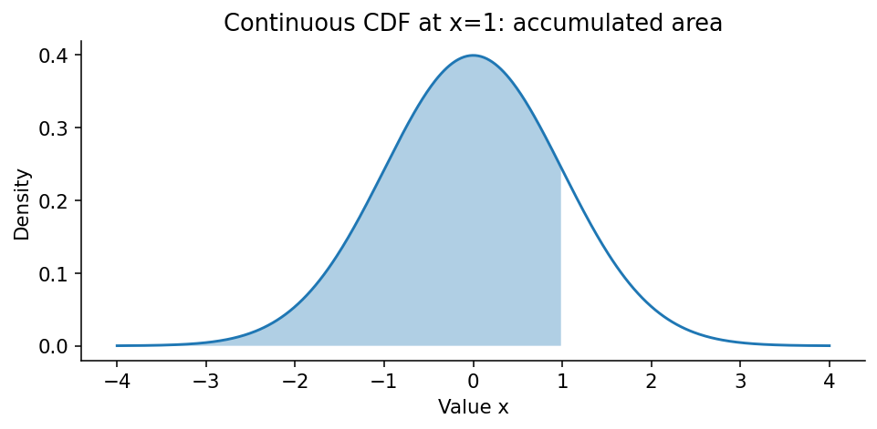

### 2. Uniform(0,10) example

$$F_X(4)=P(X\le4)=4\times0.1=0.4$$

The full CDF is:

$$F_X(x)=\begin{cases}0,&x<0\\x/10,&0\le x\le10\\1,&x>10\end{cases}$$

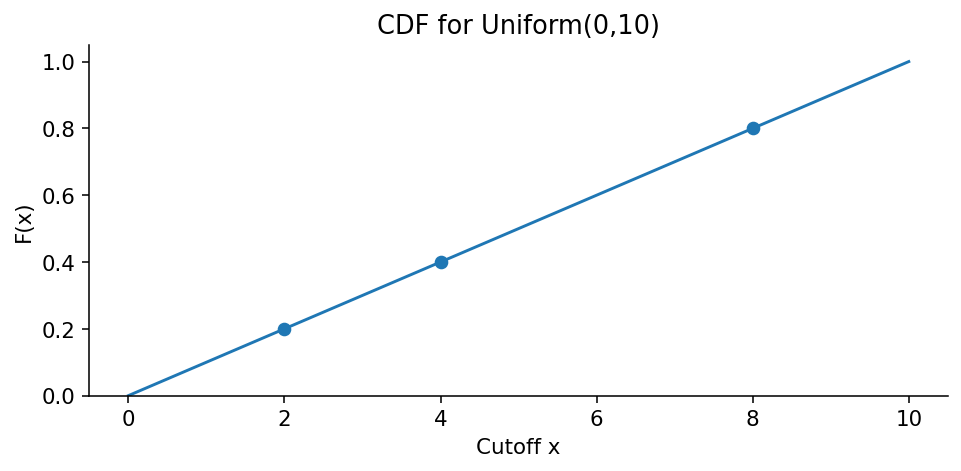

### 3. Connection to calculus
Where the CDF is differentiable:

$$\frac{d}{dx}F_X(x)=f_X(x)$$

**Intuition:** Integration accumulates density into probability; differentiation tells how fast accumulated probability grows.

**বাংলায়:** PDF থেকে CDF পেতে area যোগ করতে হয়। CDF-এর slope (যেখানে derivative আছে) হলো PDF-এর density।

---

## Page 14 — Using PDF and CDF in Data Analysis

The slide title introduces practical usage; the following delivery-time numbers are **illustrative additions**.

### 1. PDF question
“Which delivery times are relatively common?” → inspect where density is high.

### 2. CDF question
“What fraction of deliveries finish within 30 minutes?”

$$F_X(30)=P(X\le30)$$

### 3. Probability between two times
For a continuous distribution:

$$P(20\le X\le40)=F_X(40)-F_X(20)$$

Suppose $F_X(20)=0.20$ and $F_X(40)=0.85$:

$$0.85-0.20=0.65=65\%$$

**Why subtract?** $F(40)$ includes all probability up to 40; subtract the area already accumulated up to 20.

### 4. Percentiles
If $F_X(45)=0.95$, then 95% of modeled deliveries finish within 45 minutes. The **95th percentile** is a cutoff at which the CDF reaches (or first exceeds) 0.95.

**ML applications:** threshold selection, uncertainty quantification, anomaly investigation, and comparing distributions.

---

## Page 15 — 2D Probability Density Plots

### 1. One variable vs two variables
- **1D density:** how one variable (e.g. delivery time) is distributed.
- **2D density:** how two variables together (e.g. order amount and delivery time) are distributed.

### 2. Joint density

$$f_{X,Y}(x,y)$$

- $X,Y$: two continuous random variables.
- $x,y$: specific coordinates.
- $f_{X,Y}$: joint probability density at those coordinates.

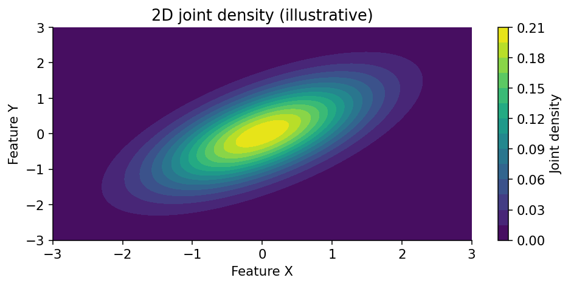

**Reading the graph:** Contours or color show where combinations are more concentrated. High density = relatively common neighborhood; low density = relatively rare neighborhood.

### 3. Region probability

$$P((X,Y)\in R)=\iint_R f_{X,Y}(x,y)\,dx\,dy$$

- $R$: a two-dimensional region.
- $\iint$: double integral; accumulate density across an area, producing probability (volume under the density surface).

**বাংলায়:** এক variable-এর বদলে দুই variable-এর combination কোথায় বেশি দেখা যায় সেটা 2D density plot দেখায়। রঙ বা contour বেশি ঘন হলে সেই region-এ data বেশি concentrated।

**Warning:** A density plot alone doesn't prove causation. For relationships, also consider scatter plots, correlation, confounders, and domain context.

**ML connection:** feature exploration, multivariate anomaly detection, clustering diagnostics.

---

## Formula Sheet

| Concept | Formula | Meaning |
|---|---|---|
| Probability (equally likely outcomes) | $P(A)=\frac{\#\text{ favorable}}{\#\text{ possible}}$ | fraction of equally likely outcomes |
| PMF | $p_X(x)=P(X=x)$ | exact discrete probability |
| PMF total | $\sum_x p_X(x)=1$ | all discrete probabilities sum to 1 |
| CDF (any RV) | $F_X(x)=P(X\le x)$ | cumulative probability |
| PDF interval probability | $P(a\le X\le b)=\int_a^b f_X(x)dx$ | area under density |
| PDF total area | $\int_{-\infty}^{\infty} f_X(x)dx=1$ | total probability |
| Continuous CDF | $F_X(x)=\int_{-\infty}^{x}f_X(t)dt$ | accumulated area |
| CDF interval (continuous) | $F_X(b)-F_X(a)$ | interval probability |
| Mean | $\bar x=\frac1n\sum_{i=1}^n x_i$ | average |
| Normal MLE variance | $\hat\sigma^2=\frac1n\sum_i(x_i-\bar x)^2$ | estimated variance under normal MLE |
| Unbiased sample variance | $s^2=\frac1{n-1}\sum_i(x_i-\bar x)^2$ | common sample variance estimator |
| KDE | $\hat f_h(x)=\frac1{nh}\sum_iK((x-x_i)/h)$ | smoothed density estimate |
| Joint region probability | $\iint_R f_{X,Y}(x,y)dxdy$ | 2D probability |

### Symbol dictionary

| Symbol | Say it as | Meaning |
|---|---|---|
| $X$ | capital ex | random variable |
| $x$ | small ex | one possible value |
| $x_i$ | ex sub i | i-th data point |
| $\sum$ | sigma / summation | add many values |
| $\mu$ | mu | mean |
| $\sigma$ | sigma | standard deviation |
| $\sigma^2$ | sigma squared | variance |
| $\hat\theta$ | theta hat | estimate of a parameter |
| $\le$ | less than or equal | includes boundary |
| $\ge$ | greater than or equal | includes boundary |
| $\sim$ | distributed as | follows a probability law |
| $\int$ | integral | accumulate tiny contributions |
| $\iint$ | double integral | accumulate over two dimensions |
| $\in$ | belongs to | is an element of a set |
| $\infty$ | infinity | no finite bound |
| $\binom nk$ | n choose k | number of selections |

---

## Common Mistakes

1. **PMF vs PDF:** PMF values are probabilities; PDF values are densities. A continuous PDF height is not the probability of one exact value.
2. **PDF height ≤ 1?** Not required. Only total area must be 1.
3. **CDF vs PDF:** CDF gives accumulated probability, PDF gives density (continuous case).
4. **Discrete interval boundaries:** $F(b)-F(a)$ gives $P(a<X\le b)$, **not** $P(a\le X\le b)$ when there is mass at $a$.
5. **Variance vs SD:** Normal notation $\mathcal N(\mu,\sigma^2)$ uses variance as its second parameter.
6. **Poisson as PDF:** Poisson is discrete; it has a PMF.
7. **KDE bandwidth:** Smaller is not automatically better; too small follows noise, too large hides structure.
8. **Density ≠ data count:** KDE curves are normalized densities, not direct counts.
9. **Parametric ≠ always bad:** If the assumed family is appropriate, it can be efficient and interpretable.
10. **2D density ≠ causation:** A visible relationship doesn't prove one variable causes the other.

---

## Practice Questions (No Answers Yet)

**Easy**
1. Number of customers visiting a shop in an hour: discrete or continuous? Why?
2. In one coin toss, $X=1$ for heads and 0 for tails. What is the PMF for a fair coin?
3. What does $P(X\le4)$ mean in Bangla?
4. Can a PMF assign 0.6, 0.5 to its only two outcomes? Why?

**Intermediate**
5. For a fair die, calculate $P(X=3)$ and $P(X\le3)$. Explain the difference.
6. For $X\sim\text{Uniform}(0,10)$, calculate $P(3\le X\le7)$ using rectangle area.
7. If $F(20)=0.25$ and $F(50)=0.80$ for a continuous variable, find $P(20\le X\le50)$.
8. Explain what happens when KDE bandwidth is too small vs too large.

**Challenge**
9. Why does $P(X=5)=0$ for a continuous variable not mean that value 5 is impossible as a measurement?
10. What is the difference between $\mathcal N(10,2)$ and $\mathcal N(10,4)$ if the second parameter is variance?
11. A discrete variable takes values 1, 2, 3 with probabilities 0.2, 0.3, 0.5. Calculate $P(2\le X\le3)$ using the PMF and the correct CDF boundary rule.
12. If a 2D density plot shows two peaks, what might that suggest about the data, and what **can't** you conclude from the plot alone?

---

## Final 60-second revision

- **Random variable:** numerical result of randomness.
- **Distribution:** possible values + probability pattern.
- **PMF:** probability of exactly a discrete value.
- **PDF:** continuous density; probability is area.
- **CDF:** probability up to a cutoff.
- **Parameters:** settings that determine distribution characteristics.
- **Density estimation:** infer distribution from observed data.
- **Parametric:** choose a family, fit its parameters.
- **Non-parametric:** estimate more flexibly from data.
- **KDE:** smooth kernels added together; bandwidth matters.
- **2D density:** density over combinations of two variables.

**One sentence to remember (বাংলা):** PMF বলে exact discrete outcome-এর probability, PDF বলে continuous data-র density, আর CDF বলে একটি value পর্যন্ত accumulated probability।
